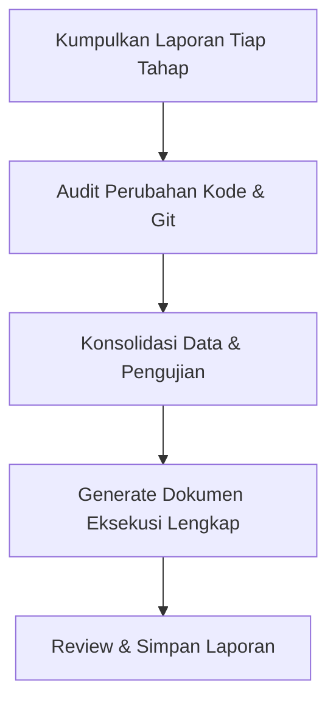

# Execution Recap (Dokumen Eksekusi Lengkap)

Skill ini digunakan untuk mengumpulkan, menyintesis, dan menyatukan laporan dari setiap tahapan kerja yang terpisah menjadi satu **Dokumen Eksekusi Lengkap (Full Execution Report)** yang profesional, terstruktur, dan siap dipresentasikan atau dijadikan arsip serah terima (handover).

---

## Kapan Menggunakan Skill Ini

Gunakan skill ini ketika:

- Pekerjaan telah melalui beberapa tahapan (misal: analisis, migrasi database, backend logic, frontend UI, testing) dan masing-masing tahap sudah memiliki laporan/log terpisah.
- Pengguna meminta: _"buatkan rekap/full report apa yang sudah dibuat"_, _"gabungkan laporan tiap tahapan menjadi dokumen eksekusi"_, _"buat laporan akhir implementasi"_.
- Perlu mendokumentasikan jejak eksekusi lengkap untuk keperluan audit teknis, code review, atau serah terima fitur.

---

## Alur Kerja Konsolidasi (Workflow)

### 1. Pengumpulan Sumber Data (Data Gathering)

Telusuri dan kumpulkan seluruh catatan dari tahapan yang sudah berjalan:

1. **Laporan & Log Tiap Tahap**:
    - Baca artefak rencana implementasi (`implementation_plan.md`).
    - Baca catatan walkthrough yang sudah ada (`walkthrough.md`).
    - Baca output/laporan dari subagent, terminal, atau skrip pengujian sebelumnya.
    - Jika diperlukan, periksa riwayat interaksi (`transcript.jsonl`) untuk menangkap keputusan penting atau kendala di tengah jalan.
2. **Audit Kode Aktual**:
    - Jalankan `git status` dan `git diff --stat` untuk memastikan daftar berkas yang benar-benar dibuat atau dimodifikasi.
    - Pastikan tidak ada file tertinggal atau perubahan yang belum terdokumentasi.

### 2. Sintesis & Pengelompokan (Synthesis)

Ekstrak data ke dalam kategori-kategori utama:

- **Kronologi Tahapan**: Urutan tahapan yang dikerjakan (Tahap 1, 2, ..., N), tujuan tiap tahap, dan status keberhasilannya.
- **Komponen Teknis**:
    - _Database & Migrations_: Skema baru, relasi, indeks, seeder.
    - _Backend & Business Logic_: Controller, Service/Action, Form Request, Middleware, Policy, Routes.
    - _Frontend & UI/UX_: Pages (Inertia/React), Komponen reusable, form, validasi sisi klien.
    - _Konfigurasi & Environtment_: Setting baru, environment variables, dependensi package.
- **Matriks Pengujian & Verifikasi**: Hasil eksekusi automated test (Pest/PHPUnit, Vitest/Jest), verifikasi manual, browser checks, atau error logs.
- **Log Kendala & Resolusi**: Isu yang sempat terjadi selama pengerjaan dan solusi yang diterapkan.

### 3. Pembuatan Dokumen Eksekusi (Document Generation)

Buat dokumen menggunakan struktur standar dari [templates/execution-report-template.md](./templates/execution-report-template.md).

Pastikan dokumen memuat:

1. **Identitas & Metadata Eksekusi**: Tanggal, nama fitur/tugas, pelaksana, status akhir.
2. **Ringkasan Eksekutif (Executive Summary)**: Gambaran tingkat tinggi mengenai apa yang dibangun dan dampaknya.
3. **Rekapitulasi Tahapan Eksekusi (Stage-by-Stage Breakdown)**: Tabel progres tiap tahapan (Nama Tahap, Deskripsi, Hasil, Status).
4. **Detail Implementasi per Komponen**: Penjelasan teknis per layer sistem (Backend, Frontend, Database, dll.).
5. **Daftar Berkas Terdampak (File Changes Manifest)**: Tabel lengkap dengan status `[NEW]`, `[MODIFY]`, atau `[DELETE]` beserta tautan berkas `file:///`.
6. **Matriks Verifikasi & Pengujian**: Hasil test cases dan validasi fungsional.
7. **Catatan Masalah & Solusi (Troubleshooting Log)**: Kendala apa yang ditemui dan bagaimana cara memperbaikinya.
8. **Panduan Pasca-Eksekusi / Serah Terima (Post-Deployment Checklist)**: Perintah yang perlu dijalankan (misal: `php artisan migrate`, `npm run build`), config yang perlu diset, dsb.

### 4. Penyimpanan & Penyajian Dokumen

1. **Tentukan Lokasi Dokumen**:
    - Jika pengguna meminta file dokumentasi proyek: simpan di `docs/reports/rekap_eksekusi_<nama_fitur>.md` atau lokasi yang diminta.
    - Jika sebagai artefak presentasi langsung: buat/perbarui artefak `walkthrough.md` atau `execution_report.md`.
2. **Tautan Berkas**:
    - Selalu gunakan tautan markdown standar yang dapat diklik: `[NamaFile.php](file:///c:/path/to/NamaFile.php)`.
3. **Konfirmasi ke Pengguna**:
    - Berikan rangkuman ringkas bahwa dokumen eksekusi telah berhasil disusun, sertakan tautan ke file dokumen yang telah dibuat.

---

## Standar Kualitas Dokumen

- **Faktual & Berbasis Bukti**: Hanya masukkan apa yang benar-benar telah dikerjakan dan diverifikasi.
- **Jelas & Terstruktur**: Gunakan heading hierarkis, tabel ringkas, callout GitHub (`> [!NOTE]`, `> [!TIP]`, `> [!IMPORTANT]`), serta code snippets.
- **Bebas Ambiguitas**: Jika ada tahapan yang belum selesai atau memiliki catatan khusus (pending/follow-up), nyatakan dengan transparan di bagian _Pending Items_.

Lihat panduan lengkap penyusunan pada [references/guidelines.md](./references/guidelines.md).
